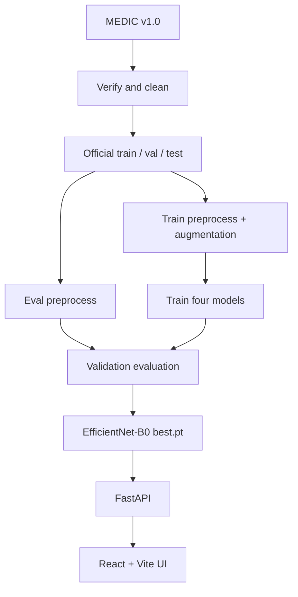
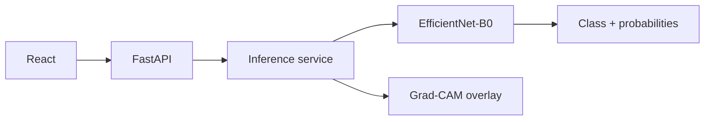
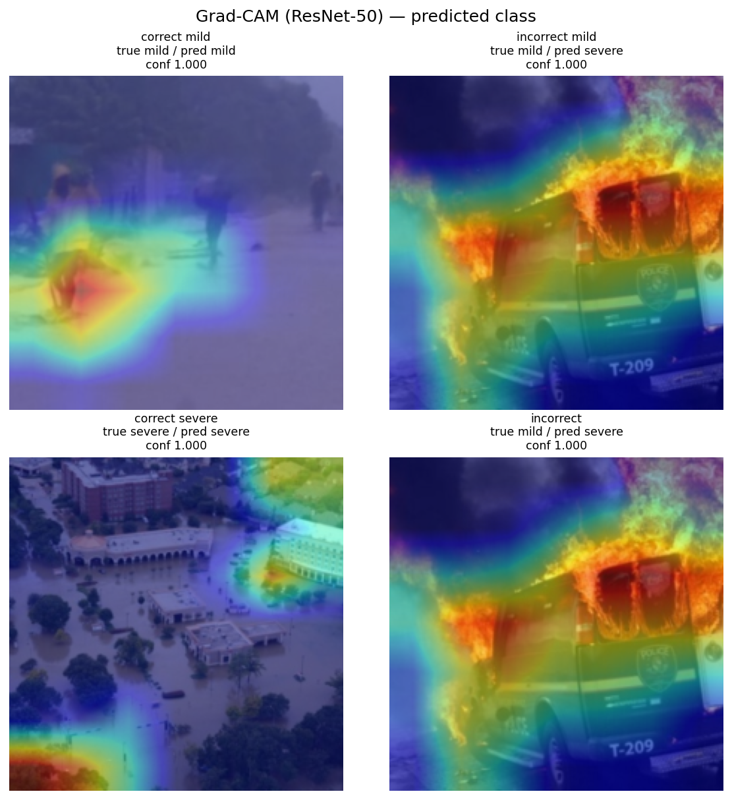
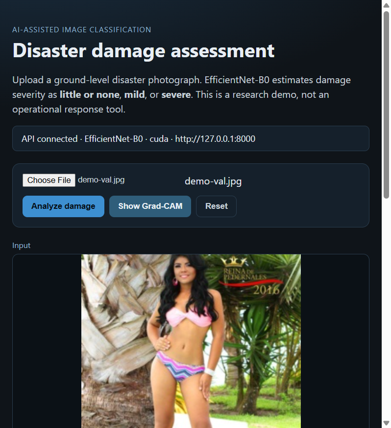

# Intelligent Disaster Damage Assessment using Deep Learning

Image-level **3-class damage severity** classification on the [MEDIC](https://crisisnlp.qcri.org/medic/) dataset (`little_or_none`, `mild`, `severe`). The repository covers the data pipeline, four PyTorch models, validation error analysis with Grad-CAM, and a **local** FastAPI + React inference app.

This is a research and engineering project. It is **not** a cloud deployment and is **not** an operational disaster-response system.


---

## Overview

After a disaster, photographs arrive faster than teams can inspect them. This project trains classifiers that map a single RGB photograph to one of three **image-level** severity labels. That is useful for triage and filtering, not for locating individual damaged buildings.

The work includes dataset cleaning, class-weighted training, a four-model comparison on **validation** metrics, error and confidence analysis, Grad-CAM visualizations, and a local upload-and-predict application served by EfficientNet-B0 (`models/efficientnet_b0/best.pt`) because that checkpoint had the highest **validation macro-F1** among the models tested.

## Key results (validation)

**Split:** MEDIC official `dev` → validation, n = 6,128. Metrics reproduced from `models/*/best.pt` in Part 3 (`reports/evaluation/part3_validation.json`). These are **not** test-set scores.

| Model | Accuracy | Macro F1 | Mild F1 | Parameters |
|---|---:|---:|---:|---:|
| LinearBaseline | 0.495268 | 0.437427 | 0.211080 | 12,547 |
| CustomCNN | 0.585346 | 0.509860 | 0.236162 | 1,173,987 |
| ResNet-50 | 0.780352 | 0.645843 | 0.315949 | 23,514,179 |
| EfficientNet-B0 | 0.765829 | 0.653169 | 0.352790 | 4,011,391 |

EfficientNet-B0 achieved the highest validation macro-F1 and Mild F1 among the four evaluated models, while ResNet-50 achieved the highest validation accuracy.

The dataset is imbalanced (mild is ~11% of validation). Macro-F1 was the checkpoint selection metric so minority-class performance is not hidden by overall accuracy.

## Final test evaluation

The test set (n = 15,630) was scored **once** after validation-based checkpoint selection. It was not used for early stopping, hyperparameter tuning, or model selection.

| Model | Test accuracy | Test macro-F1 |
|---|---:|---:|
| LinearBaseline | 0.5358 | 0.4391 |
| CustomCNN | 0.6294 | 0.5185 |
| ResNet-50 | 0.8070 | 0.6447 |
| EfficientNet-B0 | 0.7828 | 0.6418 |

Source: Part 2 experiment JSON under `reports/experiments/`.

## System architecture



Application inference:



## Dataset

**MEDIC v1.0** (Alam et al., 2023), QCRI / CrisisNLP.  
Official page: [crisisnlp.qcri.org/medic](https://crisisnlp.qcri.org/medic/)  
License: [CC BY-NC-SA 4.0](https://creativecommons.org/licenses/by-nc-sa/4.0/) (non-commercial).

MEDIC provides **image-level** damage severity labels; it does not provide bounding-box or segmentation-mask annotations used by this project.

| | Count |
|---|---:|
| Published / reconstructed labelled images | 71,198 |
| Kept after cleaning | 68,245 |
| Train (official train, cleaned) | 46,487 |
| Validation (official `dev`, cleaned) | 6,128 |
| Test (official test, cleaned) | 15,630 |

Classes: `little_or_none`, `mild`, `severe`. Auxiliary MEDIC labels (disaster type, informativeness, humanitarian) exist in the source files but are not the training target.

Details: [`docs/dataset.md`](docs/dataset.md).

## Data pipeline

1. Download MEDIC (`scripts/download_dataset.py`).
2. Verify files on disk (`scripts/verify_dataset.py`).
3. Clean unreadable, tiny, duplicate, and conflicting-label rows (`scripts/prepare_dataset.py`).
4. Keep the **official** train / dev / test assignment (mapped to train / val / test).
5. Convert to RGB; short-side resize; center crop; **224×224**; ImageNet mean/std.
6. Train-only augmentation: horizontal flip, ±15° rotation, crop, brightness/contrast/saturation.
7. Balanced **class weights from the train split** (`data/metadata/class_weights.json`).

Validation and test use the same geometric/normalization pipeline **without** augmentation. PyTorch receives CHW tensors only at the dataset/API boundary. See [`docs/data_pipeline.md`](docs/data_pipeline.md).

## Models

All heads output **3 logits**. Training code: [`docs/training.md`](docs/training.md).

| Model | Role |
|---|---|
| **LinearBaseline** | 8×8 global average pool + MLP. A floor, not a CNN. |
| **CustomCNN** | Four conv–BN–ReLU blocks from scratch, GAP, dropout, 3-class head (~1.17M params). |
| **ResNet-50** | ImageNet `IMAGENET1K_V2`, new 3-class `fc`, then last-block (`layer4`) fine-tune. |
| **EfficientNet-B0** | ImageNet `IMAGENET1K_V1`, new 3-class classifier, then last-block (`features.7`) fine-tune. |

The served application uses EfficientNet-B0 `best.pt` (validation macro-F1). ResNet-50 remains the higher-accuracy alternative on the same split.

## Training strategy

- **Framework:** PyTorch 2.6
- **Loss:** `CrossEntropyLoss` with train-split class weights
- **Optimizer:** AdamW; ReduceLROnPlateau on validation loss
- **Selection:** best **validation macro-F1**; early stopping on that metric
- **Hardware:** CUDA + AMP when available (RTX 3050 Ti in the recorded runs)
- **Seed:** 42

The dataset is imbalanced, particularly for the mild class, so macro-F1 was used to evaluate performance across classes rather than relying only on accuracy.

## Error analysis

Part 3 scored **validation** predictions from `best.pt` only ([`docs/evaluation.md`](docs/evaluation.md)).

- Mild remains the hardest class (best val Mild F1 = 0.353, EfficientNet-B0).
- True mild is more often predicted **severe** than `little_or_none` on both transfer models.
- EfficientNet-B0 recovered more true mild cases and also produced more mild **false positives**.
- ResNet-50 had higher validation accuracy.
- On softmax confidence (high ≥ 0.80), ResNet-50 had more high-confidence errors (704) than EfficientNet-B0 (217).

Normalized validation confusion matrices:

| EfficientNet-B0 | ResNet-50 |
|---|---|
|  |  |

## Explainability

Grad-CAM (last `Conv2d`, **predicted** class) was run for ResNet-50 and EfficientNet-B0. It visualizes spatial activations associated with a prediction. It is **not** causal proof of why the model assigned a label.


*EfficientNet-B0 Grad-CAM overlays on validation examples (predicted class).*



*ResNet-50 Grad-CAM overlays on validation examples (predicted class).*

## Application

Local demo only: React + Vite → FastAPI → EfficientNet-B0 `best.pt`.

- Upload / preview an image
- Predict class, probabilities, confidence, inference time
- Optional Grad-CAM overlay
- Reset; loading and error states
- Model loaded **once** at API startup
- CUDA when available, CPU otherwise

Setup: [`docs/application.md`](docs/application.md).

### Screenshot



*Local UI (`http://localhost:5173`) calling `http://127.0.0.1:8000`. Example uses a MEDIC **validation** image, not the test set.*

## API

Run from the repo root with `.venv` active:

```powershell
python -m uvicorn backend.main:app --host 127.0.0.1 --port 8000
```

| Method | Path | Purpose |
|---|---|---|
| `GET` | `/health` | Ready flag, device, class map, checkpoint path |
| `POST` | `/predict` | Multipart field `image` → JSON prediction |
| `POST` | `/explain` | Same upload → PNG Grad-CAM overlay |

Interactive docs: `http://127.0.0.1:8000/docs` · schema: `http://127.0.0.1:8000/openapi.json`

Example `/predict` body from one **validation** image (not a performance guarantee):

```json
{
  "predicted_class": "little_or_none",
  "predicted_class_index": 0,
  "confidence": 0.933453,
  "probabilities": {
    "little_or_none": 0.933453,
    "mild": 0.043642,
    "severe": 0.022905
  },
  "model": "EfficientNet-B0",
  "image_size": [224, 224],
  "inference_time_ms": 12.02,
  "device": "cuda"
}
```

## Performance

Measured on a local **NVIDIA GeForce RTX 3050 Ti Laptop GPU**. Not a universal benchmark.

| Measurement | Value |
|---|---|
| Model load (API startup, CUDA) | ~265 ms |
| CUDA inference after warmup | ~12–13 ms / image |
| CPU inference (5-run mean) | ~41 ms / image |

Load time is separate from per-image inference. The weights stay in memory after startup.

## Project structure

```text
├── backend/                 FastAPI (health, predict, explain)
├── configs/                 data_config.yaml, train_config.yaml
├── data/                    raw / processed / metadata (imagery gitignored)
├── docs/                    dataset, pipeline, training, evaluation, application
├── frontend/                React + Vite UI
├── ml/                      data, models, engine, eval
├── models/                  checkpoints (gitignored; keep best.pt locally)
├── notebooks/               01–06 exploration and experiment viewers
├── reports/                 experiments, evaluation JSON, figures
├── scripts/                 download, prepare, train, evaluate
├── tests/                   pytest (data, torch, eval, API)
├── requirements.txt
└── README.md
```

## Setup

Python **3.11**. PyTorch wheels in `requirements.txt` target CUDA 12.4; use the CPU build from pytorch.org if you have no NVIDIA GPU.

```powershell
py -3.11 -m venv .venv
.\.venv\Scripts\Activate.ps1
python -m pip install -r requirements.txt
```

**Data (Part 1)** — skip if manifests already exist under `data/processed/`:

```powershell
python scripts/download_dataset.py
python scripts/verify_dataset.py
python scripts/prepare_dataset.py
```

**API** (requires `models/efficientnet_b0/best.pt`):

```powershell
python -m uvicorn backend.main:app --host 127.0.0.1 --port 8000
```

**UI:**

```powershell
cd frontend
copy .env.example .env   # if you do not already have .env
npm install
npm run dev
```

`frontend/.env` should contain `VITE_API_URL=http://127.0.0.1:8000` (or `http://localhost:8000`). Do not commit `.env`. UI: `http://127.0.0.1:5173`.

Training and full evaluation commands (optional) are in [`docs/training.md`](docs/training.md) and [`docs/evaluation.md`](docs/evaluation.md).

## Testing

```powershell
python -m pytest tests -q
```

**40 passed** (data pipeline, PyTorch components, evaluation helpers, FastAPI). Tests do not retrain models.

## Limitations

- Local application only; no cloud deployment.
- Image-level classification only.
- MEDIC does not provide bounding-box or segmentation-mask annotations used here.
- Mild-class classification remains challenging.
- Grad-CAM is an activation visualization, not a causal explanation.
- MEDIC performance does not guarantee real-world disaster-response performance.
- External datasets have not been used for validation.

## Future work

Not implemented:

- External dataset validation
- Probability calibration
- Better handling of ambiguous / mild cases
- Localization or segmentation on a dataset that actually has those labels
- Cloud deployment
- Model monitoring and versioning

## License

This repository **does not currently include a project LICENSE file**.

The **MEDIC** images and labels are licensed separately as [CC BY-NC-SA 4.0](https://creativecommons.org/licenses/by-nc-sa/4.0/). Use of MEDIC must follow that license and the dataset terms of use.

---

Further reading: [`docs/dataset.md`](docs/dataset.md) · [`docs/data_pipeline.md`](docs/data_pipeline.md) · [`docs/training.md`](docs/training.md) · [`docs/evaluation.md`](docs/evaluation.md) · [`docs/application.md`](docs/application.md)
