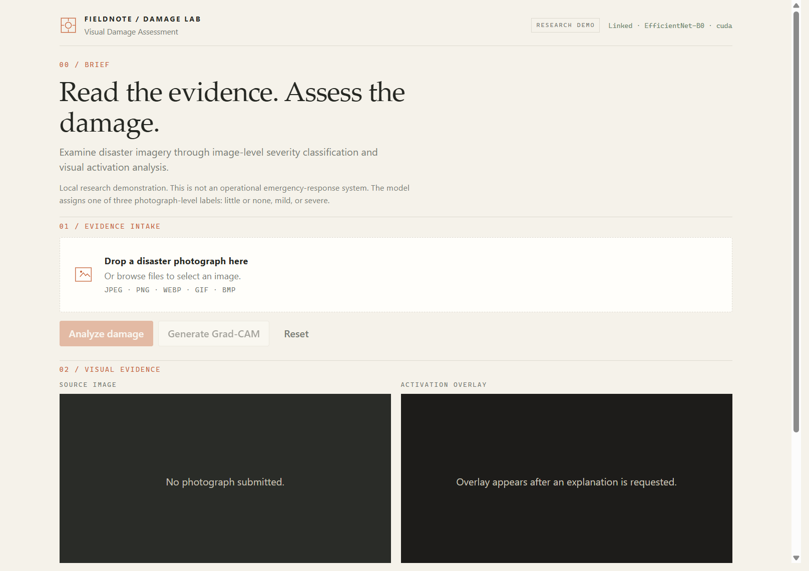
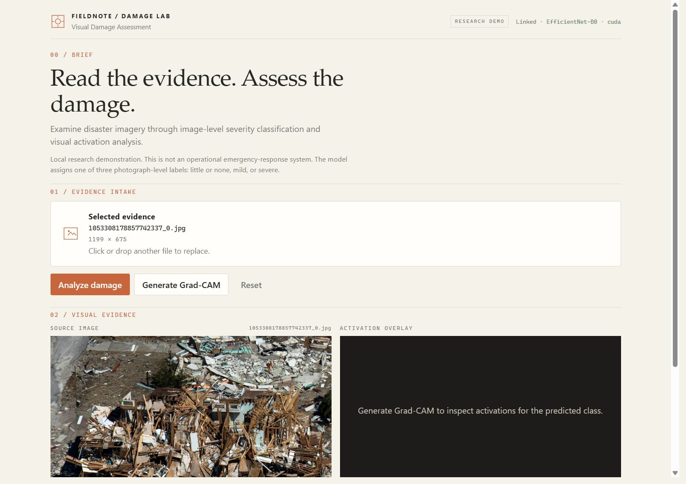
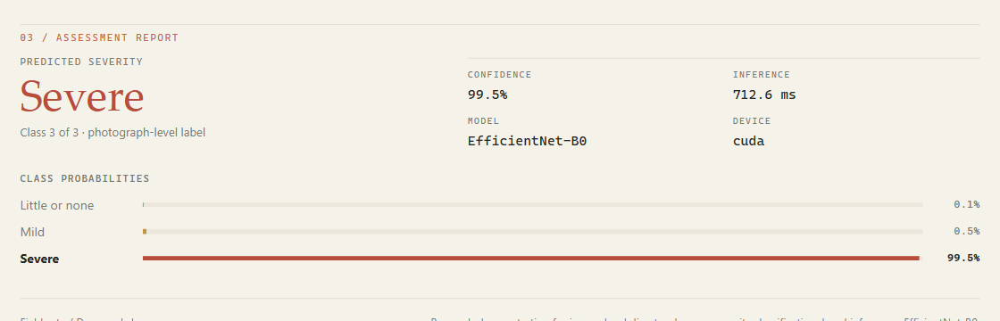
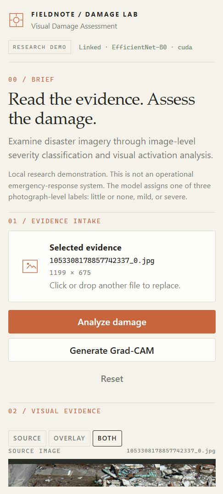
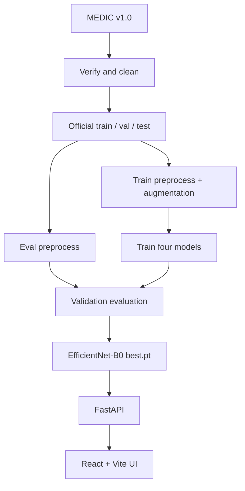
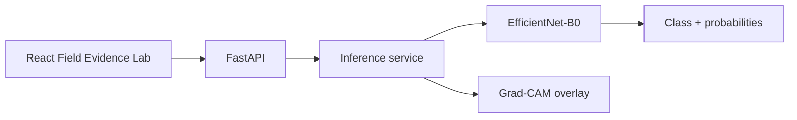
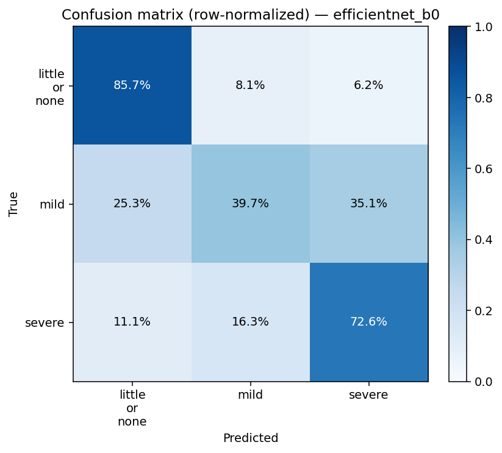
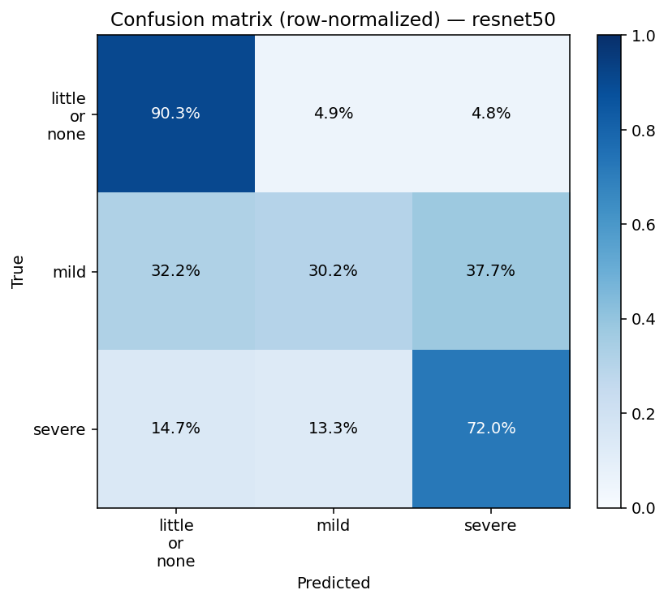

# Intelligent Disaster Damage Assessment using Deep Learning

Image-level **3-class damage severity** classification on the [MEDIC](https://crisisnlp.qcri.org/medic/) dataset (`little_or_none`, `mild`, `severe`). The repository covers the data pipeline, four PyTorch models, validation error analysis with Grad-CAM, and a **local** FastAPI + React inference app.

The local UI is branded **Fieldnote / Damage Lab** — a Field Evidence Lab style workspace for photographic intake, severity assessment, and Grad-CAM inspection.

This is a research and engineering project. It is **not** a cloud deployment and is **not** an operational disaster-response system.


---

## Overview

After a disaster, photographs arrive faster than teams can inspect them. This project trains classifiers that map a single RGB photograph to one of three **image-level** severity labels. That is useful for triage and filtering, not for locating individual damaged buildings.

The work includes dataset cleaning, class-weighted training, a four-model comparison on **validation** metrics, error and confidence analysis, Grad-CAM visualizations, and a local upload-and-predict application served by EfficientNet-B0 (`models/efficientnet_b0/best.pt`) because that checkpoint had the highest **validation macro-F1** among the models tested.

### Objectives

- Clean and prepare MEDIC official train / validation / test splits.
- Train and compare four PyTorch architectures for 3-class severity classification.
- Evaluate on validation (and a one-shot test pass) with confusion, confidence, and Grad-CAM analysis.
- Ship a local FastAPI + React demo that runs the selected EfficientNet-B0 checkpoint.

### Severity classes

| Label | Meaning |
|---|---|
| `little_or_none` | Little or none |
| `mild` | Mild |
| `severe` | Severe |

These are **photograph-level** labels. The model does not detect individual buildings or produce segmentation masks.

## Field Evidence Lab UI

The React frontend presents the demo as a compact forensic inspection workspace:

- Bone-white canvas, charcoal typography, muted slate borders, burnt-orange accents.
- Numbered sections: brief → evidence intake → visual evidence → assessment report.
- Drag-and-drop / file picker intake with preview, analyze, Grad-CAM, and reset.
- Side-by-side source image and Grad-CAM activation overlay (with accessible enlarge).
- Editorial severity report with confidence, inference time, model/device, and class probabilities.
- Responsive stacking and a Source / Overlay / Both toggle on smaller screens.

Grad-CAM highlights activations for the predicted class. It is an explanatory visualization, **not** causal proof and **not** building-level localization.

## Screenshots

Captured from the running local app against EfficientNet-B0 on a real MEDIC demo image (not the official test set).

### Image intake (empty workspace)



### Source image selected



### Assessment with Grad-CAM


*Same capture is also mirrored at [`reports/figures/app_ui.png`](reports/figures/app_ui.png) for continuity with earlier README links.*

### Assessment report detail



### Mobile layout



## Key results (validation)

**Split:** MEDIC official `dev` → validation, n = 6,128. Metrics reproduced from `models/*/best.pt` in Part 3 (`reports/evaluation/part3_validation.json`). These are **not** test-set scores.

| Model | Accuracy | Macro F1 | Mild F1 | Parameters |
|---|---:|---:|---:|---:|
| LinearBaseline | 0.495268 | 0.437427 | 0.211080 | 12,547 |
| CustomCNN | 0.585346 | 0.509860 | 0.236162 | 1,173,987 |
| ResNet-50 | 0.780352 | 0.645843 | 0.315949 | 23,514,179 |
| EfficientNet-B0 | 0.765829 | 0.653169 | 0.352790 | 4,011,391 |

EfficientNet-B0 achieved the highest validation macro-F1 and Mild F1 among the four evaluated models, while ResNet-50 achieved the highest validation accuracy.

The dataset is imbalanced (mild is ~11% of validation). Macro-F1 was the checkpoint selection metric so minority-class performance is not hidden by overall accuracy.

## Final test evaluation

The test set (n = 15,630) was scored **once** after validation-based checkpoint selection. It was not used for early stopping, hyperparameter tuning, or model selection.

| Model | Test accuracy | Test macro-F1 |
|---|---:|---:|
| LinearBaseline | 0.5358 | 0.4391 |
| CustomCNN | 0.6294 | 0.5185 |
| ResNet-50 | 0.8070 | 0.6447 |
| EfficientNet-B0 | 0.7828 | 0.6418 |

Source: Part 2 experiment JSON under `reports/experiments/`.

## System architecture



Application inference:



## Dataset

**MEDIC v1.0** (Alam et al., 2023), QCRI / CrisisNLP.  
Official page: [crisisnlp.qcri.org/medic](https://crisisnlp.qcri.org/medic/)  
License: [CC BY-NC-SA 4.0](https://creativecommons.org/licenses/by-nc-sa/4.0/) (non-commercial).

MEDIC provides **image-level** damage severity labels; it does not provide bounding-box or segmentation-mask annotations used by this project.

| | Count |
|---|---:|
| Published / reconstructed labelled images | 71,198 |
| Kept after cleaning | 68,245 |
| Train (official train, cleaned) | 46,487 |
| Validation (official `dev`, cleaned) | 6,128 |
| Test (official test, cleaned) | 15,630 |

Classes: `little_or_none`, `mild`, `severe`. Auxiliary MEDIC labels (disaster type, informativeness, humanitarian) exist in the source files but are not the training target.

A small local development subset (~100 images) may exist under `data/demo/` for demos; it is **not** the training set. Images there are gitignored.

Details: [`docs/dataset.md`](docs/dataset.md).

## Data pipeline

1. Download MEDIC (`scripts/download_dataset.py`).
2. Verify files and labels (`scripts/verify_dataset.py`).
3. Clean and write official-split manifests (`scripts/prepare_dataset.py`).
4. Train / evaluate with configs under `configs/`.

More detail: [`docs/data_pipeline.md`](docs/data_pipeline.md).

## Models and training

Four architectures are implemented under `ml/models/`:

- LinearBaseline
- CustomCNN
- ResNet-50 (ImageNet-pretrained transfer)
- EfficientNet-B0 (ImageNet-pretrained transfer)

Training uses AdamW, class-balanced CrossEntropyLoss, and validation macro-F1 for checkpointing. The official test split is isolated from selection.

Training notes: [`docs/training.md`](docs/training.md).

## Evaluation and explainability

Validation evaluation produces confusion matrices, confidence summaries, error cases, and Grad-CAM panels under `reports/figures/` and `reports/evaluation/`.





*Grad-CAM panels above are validation evaluation figures, separate from the live application screenshots.*

Evaluation notes: [`docs/evaluation.md`](docs/evaluation.md).

## Application

Local demo only: React + Vite → FastAPI → EfficientNet-B0 `best.pt`.

| Feature | Behavior |
|---|---|
| Upload / drag-and-drop | JPEG, PNG, WebP, GIF, BMP (API limit 8 MB) |
| Preview | Source frame with filename and natural dimensions when available |
| Predict | Class, probabilities, confidence, inference time, model, device |
| Grad-CAM | Optional overlay PNG from `POST /explain` |
| Reset | Clears file, prediction, and overlay |
| Health | API readiness, model, and device in the masthead |

Setup detail: [`docs/application.md`](docs/application.md).

## API

Run from the repository root with `.venv` active:

```powershell
python -m uvicorn backend.main:app --host 127.0.0.1 --port 8000
```

| Method | Path | Purpose |
|---|---|---|
| `GET` | `/health` | Ready flag, device, class map, checkpoint path |
| `POST` | `/predict` | Multipart field `image` → JSON prediction |
| `POST` | `/explain` | Same upload → PNG Grad-CAM overlay |

Interactive docs: `http://127.0.0.1:8000/docs` · schema: `http://127.0.0.1:8000/openapi.json`

Example `/predict` body from one **validation** image (not a performance guarantee):

```json
{
  "predicted_class": "little_or_none",
  "predicted_class_index": 0,
  "confidence": 0.933453,
  "probabilities": {
    "little_or_none": 0.933453,
    "mild": 0.043642,
    "severe": 0.022905
  },
  "model": "EfficientNet-B0",
  "image_size": [224, 224],
  "inference_time_ms": 12.02,
  "device": "cuda"
}
```

## Performance

Measured on a local **NVIDIA GeForce RTX 3050 Ti Laptop GPU**. Not a universal benchmark.

| Measurement | Value |
|---|---|
| Model load (API startup, CUDA) | ~265 ms |
| CUDA inference after warmup | ~12–13 ms / image |
| CPU inference (5-run mean) | ~41 ms / image |

Load time is separate from per-image inference. The weights stay in memory after startup.

## Project structure

```text
├── backend/                 FastAPI (health, predict, explain)
├── configs/                 data_config.yaml, train_config.yaml
├── data/                    raw / processed / metadata / optional demo subset
├── docs/                    guides + screenshots/
├── frontend/                React + Vite Field Evidence Lab UI
├── ml/                      data, models, engine, eval
├── models/                  checkpoints (gitignored; keep best.pt locally)
├── notebooks/               01–06 exploration and experiment viewers
├── reports/                 experiments, evaluation JSON, figures
├── scripts/                 download, prepare, train, evaluate
├── tests/                   pytest (data, torch, eval, API)
├── requirements.txt
└── README.md
```

## Setup

Python **3.11**. PyTorch wheels in `requirements.txt` target CUDA 12.4; use the CPU build from pytorch.org if you have no NVIDIA GPU.

```powershell
py -3.11 -m venv .venv
.\.venv\Scripts\Activate.ps1
python -m pip install -r requirements.txt
```

**Data (Part 1)** — skip if manifests already exist under `data/processed/`:

```powershell
python scripts/download_dataset.py
python scripts/verify_dataset.py
python scripts/prepare_dataset.py
```

**API** (requires `models/efficientnet_b0/best.pt`):

```powershell
python -m uvicorn backend.main:app --host 127.0.0.1 --port 8000
```

**UI:**

```powershell
cd frontend
copy .env.example .env   # if you do not already have .env
npm install
npm run dev
```

`frontend/.env` should contain `VITE_API_URL=http://127.0.0.1:8000` (or `http://localhost:8000`). Do not commit `.env`. UI: `http://127.0.0.1:5173`.

### Environment variables

| Variable | Where | Purpose |
|---|---|---|
| `VITE_API_URL` | `frontend/.env` | Base URL for FastAPI (default in code: `http://127.0.0.1:8000`) |

Training and full evaluation commands (optional) are in [`docs/training.md`](docs/training.md) and [`docs/evaluation.md`](docs/evaluation.md).

## Usage

1. Start FastAPI, then the Vite frontend.
2. Confirm the masthead shows API linked (model + device).
3. Drop or select a disaster photograph.
4. Click **Analyze damage** for the predicted severity, probabilities, confidence, and inference time.
5. Optionally click **Generate Grad-CAM** to inspect the activation overlay.
6. Use **Reset** to clear the workspace.

## Testing and build

```powershell
python -m pytest tests -q
```

```powershell
cd frontend
npm run build
```

**40 passed** pytest suite (data pipeline, PyTorch components, evaluation helpers, FastAPI). Tests do not retrain models.

## Troubleshooting

| Symptom | Check |
|---|---|
| UI shows backend unavailable | FastAPI running? `VITE_API_URL` matches host/port? CORS origin matches Vite URL? |
| Predict fails | File ≤ 8 MB and a supported image type? Checkpoint present at `models/efficientnet_b0/best.pt`? |
| Slow first request | Cold CUDA / model warmup; later requests are typically faster |
| Port already in use | Use another port for uvicorn and update `VITE_API_URL` accordingly |

## Limitations

- Local application only; no cloud deployment.
- Image-level classification only.
- MEDIC does not provide bounding-box or segmentation-mask annotations used here.
- Mild-class classification remains challenging.
- Grad-CAM is an activation visualization, not a causal explanation.
- MEDIC performance does not guarantee real-world disaster-response performance.
- External datasets have not been used for validation.

## Future work

Not implemented:

- External dataset validation
- Probability calibration
- Better handling of ambiguous / mild cases
- Localization or segmentation on a dataset that actually has those labels
- Cloud deployment
- Model monitoring and versioning

## License

This repository **does not currently include a project LICENSE file**.

The **MEDIC** images and labels are licensed separately as [CC BY-NC-SA 4.0](https://creativecommons.org/licenses/by-nc-sa/4.0/). Use of MEDIC must follow that license and the dataset terms of use.

---

Further reading: [`docs/dataset.md`](docs/dataset.md) · [`docs/data_pipeline.md`](docs/data_pipeline.md) · [`docs/training.md`](docs/training.md) · [`docs/evaluation.md`](docs/evaluation.md) · [`docs/application.md`](docs/application.md)
